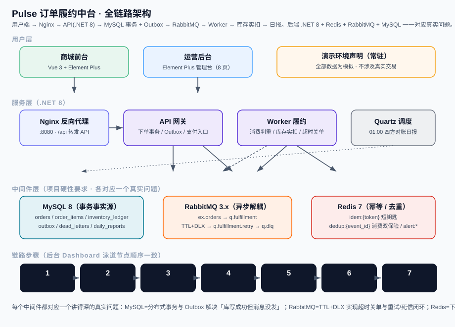

# Pulse · 订单履约中台（作品集演示站）

> **演示环境 · 全部数据为模拟 · 不涉及真实交易。本项目不是生产系统。**
> 边界与未实现能力见 [`docs/BOUNDARIES.md`](docs/BOUNDARIES.md)。

一个用来把 MySQL / Redis / RabbitMQ 讲透的全栈作品集项目：完整订单履约链路 + Element Plus 运营后台 + 三个可复现实验。正式规格见 [`docs/SPEC.md`](docs/SPEC.md)，实施计划见 [`docs/PLAN.md`](docs/PLAN.md)。

## 技术栈

| 层 | 选型 |
|---|---|
| 后端 | .NET 8 / ASP.NET Core（C#） |
| 存储 | MySQL 8（本地演示用 SQLite） |
| 缓存 | Redis 7 |
| 消息 | RabbitMQ 3.13（TTL+DLX 做超时关单） |
| 前端 | Vue 3 + TypeScript + Vite + Element Plus |
| 编排 | Docker Compose |

## 当前完成度：M6d + M7（成熟商城前台 + 成熟后台运维 + 技术证据外显 + A11 浏览器实测 + 生产加固与部署指南）

已具备：

- **M0/M1**：解决方案骨架、6 张表 EF Core 模型与 MySQL 初始迁移、下单事务（库存预扣 + 乐观锁、库存流水、outbox、幂等键、15 分钟过期）、下单相关 API。
- **M2**：Outbox Publisher（publisher confirms + 状态回写）、RabbitMQ 拓扑（`ex.orders` + 4 队列，TTL+DLX，不含插件）、Redis `idem:{token}` 短钥匙、Worker 宿主接线。
- **M3**：`processed_events` / `dead_letters` 两表与迁移、消费端幂等双保险（`dedup:{event_id}` SETNX + 唯一键）、库存实扣与 `Deduct` 流水、支付入口同事务写 `order.paid`、超时关单释放预扣、三次重试入死信与人工补偿、消费者编排、支付与补偿台 API。
- **M4**：后端补 `/cancel` `/ship`、订单列表筛选分页、详情状态时间线、日报即时四方对账、批量改价；前端用户端 4 页（商品 / 购物车 / 结算 / 支付结果）+ Element Plus 后台 5 页（订单 / 库存 / 发货 / 对账 / 死信台）、`3 秒轮询 + 写操作后立即刷新`（无 SignalR）、Vitest 契约与纯函数测试、路由级 code-split。

- **M5**：`daily_reports` / `experiment_results` / `alert:*` / `lab_controls` 四张表与第 3 条 MySQL 迁移；Quartz 每日 01:00（Asia/Shanghai）日报落表（`stat_date` 幂等 upsert，RAMJobStore）；仪表盘真实队列深度、站内告警与 Redis `alert:silence:{key}` 静默、流量生成器 / 故障注入 / 一键重置、E1–E3 实验编排；前端补 `/admin/dashboard`、`/admin/alerts`、`/admin/lab` 三页（后台导航扩到 8 项）。
- **M6a**：规格 v0.2 变更落盘（成熟商城前台 + 后台运维 + 技术证据外显）；`shopNav`、7 条用户端路由、两套 Layout 骨架、`TechEvidenceCard`、真实实验数字纯函数 `parseLatestEvidence`、`/about` 真实页面。
- **M6b**：后端 `POST /api/orders` 向后兼容支持 `items[]` 多明细（同事务多行 `order_items` / 预扣 / `Reserve` 流水 / 一行 outbox），`/api/products` 加 `version`、`/api/orders` 加 `orderNo` 筛选，消费端履约 / 超时关单改按 `order_items` 逐行处理；前端重写商城 6 页（首屏定位 + 三中间件 + 真实实验数字 + 商品卡片网格 / 搜索 / 分类 / 排序、详情库存三态、多行购物车、多明细结算、我的订单、订单详情），接 `ShopLayout`，删除「进页面自动支付」改为明确标注的「模拟支付 · 演示」按钮，商品详情 / 结算 / 我的订单 / 订单详情四页挂「本页技术证据」卡。

- **M6c**：新增 `GET /api/pipeline` 聚合端点（7 个链路节点的**真实计数**，分别来自 `Orders` / `OutboxMessages` / `QueueDeclarePassive` / `ProcessedEvents` / `InventoryLedgers` / `DeadLetters` / `DailyReportRecords`；队列不可用时 `count=-1 + available=false`，前端显示「—」不伪造 0）；`/admin/dashboard` 加 7 节点可点击泳道 + E1/E2/E3 最新真实结果卡；`AdminLayout` 统一接线全局健康条（`AdminHeader`）、面包屑、每页固定「本页技术证据」卡（`utils/adminEvidence.ts` 为 8 页元数据唯一真源）；8 个后台页补齐空态 / 操作反馈 / 3 秒轮询 / 写后立即刷新；容器以 **Production** 运行也开放 Swagger（默认启用，可用 `Swagger__Enabled=false` 关闭），nginx 新增 `/swagger/` 反代。
- **M6d**：`docs/architecture.svg` 全链路架构图（用户层 / 服务层 / 中间件层 / 7 步链路，与后台泳道一一对应）；**A11 浏览器逐页点击实测用真实 chromium 跑通**（`tests/e2e/a11-click.mjs`，`http://localhost:8080` 真容器，**21/21 PASS**，含「下单 → 模拟支付 → Worker 异步履约 → 已发货」全链路闭环与 8 个后台页统一证据卡），证据截图在 `docs/screenshots/`；演示视频（`docs/screenshots/demo.webm`，12.8s 录屏）由 Playwright 生成，**GIF 待完整 ffmpeg 转制**（本机仅 Playwright 精简 ffmpeg 缺 GIF muxer，转制命令见 `docs/PLAN.md`「演示 GIF 转制」）。

- **M7**：生产部署加固与完整部署指南（见 [`docs/DEPLOYMENT.md`](docs/DEPLOYMENT.md)）。新增独立 `docker-compose.prod.yml`（**不暴露任何宿主端口**：mysql/redis/rabbitmq/api/worker 仅内网互通，web 仅容器内 80 由 Caddy 边缘代理对外发布）；API 注入 `Swagger__Enabled=false` 公网关闭 Swagger；Redis `requirepass` + RabbitMQ 独立账号（连接串自动带凭据）；`restart: unless-stopped` + 资源上限；配套 `deploy/Caddyfile` + `deploy/docker-compose.edge.yml`（Caddy 自动 HTTPS）+ `.env.prod.example` 密钥模板。用生产覆盖干净重建**真容器验证**：宿主端口全部收回、`/api/health` 与 `/api/products` 200、`/swagger/v1/swagger.json` 与 `/swagger/index.html` 经 nginx 与 api 直连**均 404**、带口令链路跑通「下单 → 模拟支付 → 已发货」（pipeline `orders=1/worker=1/deduct=1/deadLetter=0`）。

**已完成 C 层 Docker 验收**：`docker compose down -v && docker compose up -d --build` 六服务干净重建实测跑通，真实 MySQL 8 三条迁移应用、Redis 7 / RabbitMQ 3.13 真连接；`python3 scripts/verify_docker_e2e.py --deep --m5 --experiments --m6 --m6c` **175 / 175 PASS**（153 条 M6b 基线一条未退化 + 22 条 M6c 新断言），含 E1/E2/E3 真实判据全部 `passed=true`。详见下方验证结果表与 `docs/PLAN.md`。

## 全链路架构（一眼看懂技术叙事）



每个中间件都对应一个讲得深的真实问题：

- **MySQL 8（事务事实源）**：下单用事务写 `orders` + `order_items` + 库存预扣 + `Reserve` 流水 + `outbox`，再用事务性 Outbox 解决「库写成功但消息没发」；`Orders.Status` 用 `HasConversion<int>()` 落整数。
- **RabbitMQ 3.13（异步解耦）**：`ex.orders → q.fulfillment`，超时关单用 TTL + DLX（不依赖 delayed-message 插件）；三次重试走 `q.fulfillment.retry`，最终进 `q.dlq.fulfillment` 由人工补偿台重投。
- **Redis 7（幂等 / 去重）**：下单 `idem:{token}` 短钥匙（命中返回同一笔订单）；消费端 `dedup:{event_id}` SETNX 双保险防重复履约；告警用 `alert:seen:` / `alert:silence:`。

浏览器不直连 MQ / WebSocket：状态用 **3 秒轮询 + 写操作后立即刷新**，避免长连接、断线重连与 Redis backplane。运营后台每个页面固定「本页技术证据」卡，把中间件、真实键表名与一键复现入口外显出来。

**M7 公网部署已完成（生产加固 + 部署指南）**：新增 `docker-compose.prod.yml`（收回全部宿主端口、Redis/RabbitMQ 加口令、`Swagger__Enabled=false`）、`deploy/Caddyfile` + `deploy/docker-compose.edge.yml`（Caddy 自动 HTTPS）与 `docs/DEPLOYMENT.md` 部署指南；**`Swagger__Enabled=false` 关闭路径已用生产覆盖干净重建真验**（nginx 与 api 直连 `/swagger/...` 均 404），详见该节。**真实公网域名 TLS 部署需自备域名 / 服务器 / ICP 备案，仅作文档、未在本机跑真实证书签发**。另有两项明确不做 / 未做：单笔 `/admin/pipeline` 追踪页、`GET /api/orders/{id}` 的 `evidence` 链路计数子对象。**A11 浏览器逐页点击实测已完成**（真实 chromium 21/21 PASS），见 `docs/screenshots/` 与 `tests/e2e/a11-click.mjs`。**仍未验证**：真实等待 15 分钟 TTL 自然到期、Quartz 到点自动触发、真实公网域名 TLS 部署（需自备环境）。详见 `docs/BOUNDARIES.md` 第 7 节。

## 生产部署（公网演示站）

完整指南见 [`docs/DEPLOYMENT.md`](docs/DEPLOYMENT.md)，核心交付：

- `docker-compose.prod.yml`：独立生产 compose，**不暴露任何宿主端口**（mysql/redis/rabbitmq/api/worker 仅内网），`Swagger__Enabled=false` 关闭 Swagger，Redis/RabbitMQ 加口令，`restart: unless-stopped` + 资源上限。
- `deploy/Caddyfile` + `deploy/docker-compose.edge.yml`：Caddy 边缘代理，自动 HTTPS 发布 80/443。
- `.env.prod.example`：强随机口令模板（`.env.prod` 已被 `.gitignore` 忽略）。
- 本地已真验：端口收回、`/api/health`·`/api/products` 200、Swagger 关闭（404）、带口令链路「下单→模拟支付→已发货」跑通。真实域名 TLS 需自备环境。

### 可用接口

| 方法 | 路径 | 说明 |
|---|---|---|
| GET | `/api/health` | 健康检查，含当前数据库 provider |
| GET | `/api/products` | 商品与库存三态 + `version`（乐观锁版本号） |
| POST | `/api/orders` | 下单：单 SKU body `{ sku, quantity, idempotencyKey }`，或多明细 `{ items: [{ sku, quantity }], idempotencyKey }`；两者互斥，同传 / 空数组 → 400 |
| GET | `/api/orders?status=&sku=&orderNo=&from=&to=&page=&pageSize=` | 订单列表，多条件筛选（`orderNo` 模糊匹配）+ 分页 |
| GET | `/api/orders/{id}` | 订单详情含多明细与状态时间线 |
| POST | `/api/orders/{id}/pay` | 模拟支付，同事务写 `order.paid` outbox |
| POST | `/api/orders/{id}/cancel` | 取消（`Created → Cancelled`），释放预扣 |
| POST | `/api/orders/{id}/ship` | 发货（`Paid → Shipped`） |
| GET | `/api/reports/daily?date=yyyy-MM-dd` | 日报即时聚合 + 四方对账；`persisted` 标记该日是否已落 `daily_reports` |
| POST | `/api/products/prices` | 批量改价，body：`[{ sku, price }]` |
| GET | `/api/dead-letters?status=` | 死信列表（支持 status 筛选） |
| POST | `/api/dead-letters/{id}/retry` | 人工补偿重试 |
| GET | `/api/dashboard` | 今日指标 / 库存告警 / 4 个队列真实深度 / 运行态开关 |
| GET | `/api/pipeline` | 链路泳道 7 节点真实计数（M6c），`{ generatedAtUtc, nodes: [{ key, label, middleware, count, unit, source, available, link }] }` |
| GET | `/api/alerts?limit=50` | 站内告警列表（扫描死信 / 低库存 / 队列积压） |
| POST | `/api/alerts/{key}/silence` | 静默告警，body：`{ minutes }`（1–1440，Redis `alert:silence:{key}` TTL） |
| GET | `/api/lab/state` | 消费者 / Publisher / 故障注入开关与依赖配置状态 |
| POST | `/api/lab/traffic` | 流量生成器，body：`{ sku, count, rps, quantity, concurrency? }`，返回吞吐 / P99 |
| POST | `/api/lab/inject` | 故障注入，body：`{ type, count?, orderNo? }`，7 种 type（重复消息 / 开关 / 履约异常） |
| POST | `/api/lab/reset` | 一键清空演示数据并重新播种 2 个 SKU |
| GET | `/api/experiments` | 实验结果留痕（`params` / `result` 为 JSON 字符串） |
| POST | `/api/experiments/run` | 跑 E1 / E2 / E3，body：`{ name }`，返回真实判据与量化数据 |

```bash
# 下单
curl -X POST http://localhost:5080/api/orders \
  -H 'Content-Type: application/json' \
  -d '{"sku":"SKU-1","quantity":2,"idempotencyKey":"demo-001"}'

# 支付（id 从订单详情或演示库取）
curl -X POST http://localhost:5080/api/orders/1/pay

# 死信列表
curl http://localhost:5080/api/dead-letters
```

## 启动

**方式 A：一键启动（推荐）**

```bash
cp .env.example .env
docker compose up -d
# 前端 http://localhost:8080  API http://localhost:5080/api/health
# Swagger UI http://localhost:8080/swagger/index.html （22 个端点，含 /api/pipeline；Swagger__Enabled=false 可关闭）
# RabbitMQ 管理台 http://localhost:15672 (guest/guest)
# 六个服务：mysql / redis / rabbitmq / api / web / worker
```

**已在 Docker Desktop 29.9.2（macOS arm64）实测验证**：三个应用镜像构建成功，三个中间件 healthcheck 全部 healthy，API 在真实 MySQL 8 上自动完成三条 EF Core 迁移并播种；`docker compose down -v && docker compose up -d` 的干净重启也已复跑通过。

> 国内网络提示：`mcr.microsoft.com/dotnet/sdk:8.0` 不走 Docker Hub 的 registry mirror，直连可能极慢。可预拉后打回官方 tag（**不改项目里任何 Dockerfile**）：
>
> ```bash
> docker pull mcr.m.daocloud.io/dotnet/sdk:8.0
> docker pull mcr.m.daocloud.io/dotnet/aspnet:8.0
> docker tag mcr.m.daocloud.io/dotnet/sdk:8.0 mcr.microsoft.com/dotnet/sdk:8.0
> docker tag mcr.m.daocloud.io/dotnet/aspnet:8.0 mcr.microsoft.com/dotnet/aspnet:8.0
> ```

**一键复跑端到端验证**（会写入演示订单，建议先清空数据再跑）：

```bash
docker compose down -v && docker compose up -d
python3 scripts/verify_docker_e2e.py --deep --m5 --experiments --m6 --m6c
# --deep        M3 异步链路：超时关单 / 三次重试入死信 / 人工补偿重投
# --m5          9 个新端点逐字段契约 + 控制开关跨 API/Worker 进程生效 + 一键重置
# --experiments E1 消息不丢 / E2 消费幂等（1000 条重复）/ E3 并发不超卖 真实跑
# --m6          M6b items[] 多明细 → 模拟支付 → Worker 异步履约 → 四方对账 diff=0
# --m6c         M6c /api/pipeline 7 节点真实计数（逐项比对 MySQL） + 容器 Production 下 Swagger JSON / UI
# 干净重启后实测 175 / 175 PASS（153 条 M6b 基线不退化 + M6c 22 条）
# 会写入演示订单，跑完可用 POST /api/lab/reset 清空（实验留痕会保留）
```

**方式 B：不用 Docker 的本地开发**（默认 SQLite，零外部依赖即可演示下单 / 支付链路；compose 里覆盖为 MySQL）

```bash
dotnet run --project src/Pulse.Api        # http://localhost:5080
dotnet run --project src/Pulse.Worker     # 后台 Outbox Publisher 与消费者宿主；无 MQ 配置时空转
cd web && npm install && npm run dev      # http://localhost:5173，/api 已代理到 5080
# 用户端 http://localhost:5173/  运营后台 http://localhost:5173/admin/orders
```

> 本地演示库 `pulse-demo.db` 启动时自动建表并播种两个 SKU，文件已在 `.gitignore` 中。schema 升级后旧库会缺表，共用的 `DemoDatabaseInitializer` 会重建演示库（演示数据本就可清空），因此本地重启后演示订单不保留。

## 已实测的验证结果

| 命令 / 项目 | 结果 |
|---|---|
| `dotnet build src/Pulse.sln` | 通过，**0 warning / 0 error** |
| `dotnet test src/Pulse.sln` | 通过：**211 passed**（Domain 3 + Infrastructure 159 + Api 49），M6b 基线 207 → M6c 新增 4（`PipelineService` 服务层 + `/api/pipeline` 端点集成测试） |
| `npm test` / `npm run build` | 通过：**167 passed**（26 个 Vitest 文件，M6b 149 → M6c 新增 18）；`vue-tsc --noEmit` 0 error，`vite build` 0 error，最大 chunk **255.21 kB**（仍 < 500 kB；较 M6a 的 171.27 kB 增大，原因是 `App.vue` 静态接入 `ShopLayout` 把 `ElMenu` 等带进主 chunk） |
| M0–M5 逐轮 RED 证据 | 均保留（编译错误 / 断言失败）；M1 API 薄适配层「先实现后补测」、M5 `persisted` 未单独先红两处纪律偏差如实记录在 `docs/PLAN.md` |
| 本地端到端契约联调（A 层） | M4 **33 / 33 PASS**；M5 **30 / 30 PASS**（主会话逐字段按 `web/src/api/types.ts` 核对真 API 响应，含 `id` number、`params`/`result` JSON 字符串、默认开关 true/true/false、静默 404 边界） |
| `docker compose up -d --build`（Docker Desktop 29.9.2） | **通过**：六服务启动，三个中间件 healthcheck 全 healthy；容器内 `dotnet restore`（含新增 Quartz 3.13.0）、`dotnet publish`、`npm run build` 均跑通 |
| MySQL 8 迁移应用 | **通过**：3 条迁移真实应用（`InitialCreate` / `M3ConsumptionAndCompensation` / `M5LabAndReports`），**12 张表**，启动自动播种 2 个 SKU |
| Redis 7 / RabbitMQ 3.13 真连接 | **通过**：`dedup:{event_id}` SETNX、`alert:silence:{key}` 静默键真实写入；`ex.orders` + 4 队列、`q.fulfillment` 消费者在线、publisher confirms、手动 ack、passive declare 队列深度 |
| **容器端到端 `scripts/verify_docker_e2e.py --deep --m5 --experiments --m6 --m6c`** | 干净重启后 **175 / 175 PASS**：153 条 M6b 基线（M3 异步链路 / 9 个端点契约 / 跨进程开关 / 一键重置 / E1–E3 / 多明细履约）**一条未退化** + M6c 新增 22 条断言（泳道 7 节点 DTO 逐字段 + 6 项计数与 MySQL 真实行数逐项比对 + 队列深度与管理台比对 + Swagger JSON/UI 经 nginx 与 api 直连） |
| **M6c 泳道计数是真查询（真容器）** | `orders=1 / outbox=0 / exchange=0 / worker=1 / deduct=2 / deadLetter=0 / report=0`，逐项与 `Orders` / `OutboxMessages(status=pending)` / `q.fulfillment` 深度 / `ProcessedEvents` / `InventoryLedgers(ChangeType=Deduct)` / `DeadLetters(status=pending)` / `DailyReportRecords` 的 SQL 真实行数相等；`available=false` 才允许 `count=-1`，不伪造 0 |
| **M6c Swagger（容器 Production）** | nginx 8080 与 api 5080 直连的 `/swagger/v1/swagger.json` 均 200 且 `Content-Type: application/json`（**不是 SPA 回退 HTML**），`openapi=3.0.1`、**22 个 path** 含新增 `/api/pipeline` 与原有 `/api/orders`；`/swagger/index.html` 返回含 `swagger-ui` 的真实 UI 页 |
| **M6b 多明细真链路（真容器）** | `items[]` 2 个 SKU × 2/3 件 → 2 行 `order_items` + 2 行 `Reserve` 流水 + 两个 `version` 各 +1 + 1 行 outbox；同幂等键重放返回同一 id；`orderNo` 模糊命中；模拟支付后 Worker 写出 **2 行 Deduct（2/3，不是只扣第一个 SKU）**、`reserved` 归零、四方对账 `diff=0` |
| **E1 消息不丢**（真实判据 `passed=true`） | 停 Publisher → 造 20 单 → `pendingBefore=20` → 恢复 → `pendingAfter=0`、`published=20`、四方对账 `diff=0` |
| **E2 消费幂等**（真实判据 `passed=true`） | 同一 `event_id` 直投 **1000 条** `order.paid`，`confirmed=1000`，该订单 `Deduct` 流水 **1 条**、`processed_events` **1 行** |
| **E3 并发不超卖**（真实判据 `passed=true`） | 100 单 / 并发度 10：`created=11`、`failed=89`、`oversoldCount=0`、`reserved=11` 与 `Reserve` 流水 11 一致。吞吐 / P99 随机器负载波动，三次真跑：M5 首次 **75.97 RPS / P99 32.08 ms**，M6b 复跑 **92.79 RPS / P99 22.18 ms**，M6c 复跑 **83.45 RPS / P99 40.42 ms**；页面只展示 `experiment_results` 里的最新真实值，不写死数字 |
| **A11 浏览器逐页点击实测（真实 chromium，2026-11-07）** | `tests/e2e/a11-click.mjs` 指向 `http://localhost:8080` 跑通 **21/21 PASS**：商城首屏（三中间件 + 常驻演示声明）→ 商品详情 → 加入购物车 → 购物车 → 结算 → 下单 → **模拟支付 → 轮询到「已发货」全链路闭环**（证明 RabbitMQ → Worker → MySQL 真实跑通）→ 后台 7 节点泳道 7/7（真实计数 `orders=1 / deduct=1 / worker(processed)=1`）+ E1/E2/E3 实测卡 → 8 个后台页统一「本页技术证据」卡 8/8；证据截图见 `docs/screenshots/` |
| E3 失败归因（独立取证） | 另做 100 并发 HTTP 探测：**88 个 409 全部是「库存并发冲突，请重试」**（乐观锁 `Inventory.Version`），**0 个库存不足**；`available=88`、`reserved=12` 与成功单数一致。即高并发成功率低是「冲突不自动重试」的有意取舍，换来超卖率 0，不是缺陷 |
| C 层发现并修复的 2 个真实缺陷（历史） | ① `dedup:` 键双前缀 `idem:dedup:`；② 失败消息未释放短钥匙导致重试 / DLQ 闭环失效。均严格 RED-GREEN |
| 浏览器实际点击交互 | **未验证**（Vitest / `vue-tsc` / HTTP 层已过；本轮只做了 SPA 6 条路由与构建产物 JS 的 200 冒烟，未用浏览器点击验证路由跳转、3 秒轮询可视效果、弹窗与表格交互） |
| 真实等待 15 分钟 TTL 到期 | **未验证**：核对了 `x-message-ttl=900000` + DLX 参数，并通过管理台直投 `order.timeout` 验证 DLX **之后**的消费路径；未等满 15 分钟 |
| Quartz 到点自动触发 | **未验证**：验证了 `StdSchedulerFactory` + cron `0 0 1 * * ?`（Asia/Shanghai）+ Worker 干净启动 0 异常与 `daily_reports` upsert 单测；未实际等到 01:00 触发 |
| 公网部署 / 演示 GIF / README 架构图 / 浏览器逐页点击（A11） | **未做**（M6d / M7） |
| `Swagger__Enabled=false` 关闭路径 | **未验证**：默认开放已实测（经 nginx + api 直连）；关闭分支只做了实现（读配置字符串），**未在真容器注入该环境变量实测** |
| `GET /api/orders/{id}` 的 `evidence` 链路计数子对象 | **明确不做**：SPEC v0.2 允许延后到 M6c，M6c 6.13 决议以「Dashboard 泳道 + 可点击节点」满足 G2'，不另做单笔 `/admin/pipeline` 追踪页；订单详情页在字段缺失时明确显示「不伪造 0」，只给中间件 / 真实键表名的证据卡 |

未跑过的验证一律不写「通过」；后续里程碑结果继续追加到这张表。

## 设计取舍（摘要）

- **outbox + publisher confirms**：解决「DB 写成功但 MQ 没发出去」，配合消费端幂等形成不丢不重闭环。
- **TTL+DLX 而非延迟消息插件**：演示超时时长固定，`docker compose` 少一个插件依赖。
- **3 秒轮询而非 SignalR**：后台是低频查看页面，长连接属于过度设计；浏览器不直连消息总线。
- **RabbitMQ 而非 Kafka**：本项目要的是任务队列的重试 / 死信 / 逐条确认语义，不是日志重放。
- **实验台开关落 `lab_controls` 表而非 Redis**：开关必须跨 API / Worker 两个进程生效，本地 SQLite 演示模式没有 Redis；DB 方案在两种 provider 下行为一致。Redis 留给 SPEC 指定的 `alert:silence:{key}`。
- **队列深度用 `QueueDeclarePassive` 而非管理台 HTTP API**：避免 guest 远程登录限制与额外凭据；不可用时返回 `available:false` 并显示「—」，不伪造 0。
- **乐观锁冲突不自动重试**：并发抢同一 SKU 时 `Inventory.Version` 冲突直接 409，保证超卖率 0 但成功率低（E3 实测 100 单成功 11 单）。演示的是「不超卖」而非高并发吞吐，生产化需重试 / 队列化。
- **Quartz 用 RAMJobStore（已记录的有意偏移）**：SPEC 写的 ADO.NET JobStore + `qrtz_*` 官方表本里程碑未落；单实例演示靠 `stat_date` 唯一键 upsert 保证重跑幂等。详见 `docs/BOUNDARIES.md` 第 3、6 节。
- **多明细以 `order_items` 为事实源**：MQ payload 里仍带首行 `sku/quantity` 与 `items[]` 仅为兼容 M1/M3 单消息语义；履约 / 超时关单按数据库明细逐行扣减 / 释放，避免「只处理第一个 SKU」的库存泄漏。
- **商城观感靠自写 CSS + 内联 SVG**：不引入新 UI 库、不引入商品图片 CDN；Element Plus 仍只负责后台与表格 / 表单 / 弹窗等控件。

完整取舍记录见 `docs/BOUNDARIES.md` 第 6 节。

## 文档索引

| 文件 | 内容 |
|---|---|
| `docs/SPEC.md` | 已确认的正式规格（目标、数据模型、消息拓扑、验收 A1–A10、里程碑） |
| `docs/PLAN.md` | 实施计划：M0–M7 的 2–5 分钟粒度任务、锁定的 DTO 契约表（含 `GET /api/pipeline`）、逐轮 RED/GREEN 执行记录 |
| `docs/BOUNDARIES.md` | 边界说明：演示声明、未实现能力、上线还差什么、验证状态 |
| `docs/design.md` | 选型讨论历史（已由 SPEC 取代） |
| `docs/archive/` | 更早的实时大屏草案存档，非规格 |
| `scripts/verify_docker_e2e.py` | Docker 六服务端到端验证脚本：默认同步链路；`--deep` 超时 / 重试 / 死信 / 补偿；`--m5` 九个新端点契约 + 跨进程控制开关；`--experiments` E1/E2/E3 真跑；`--m6` 多明细下单 → 支付 → 履约 → 对账；`--m6c` 泳道 7 节点真实计数 + 容器 Swagger。五 flag 全开干净重启实测 **175 / 175 PASS** |
